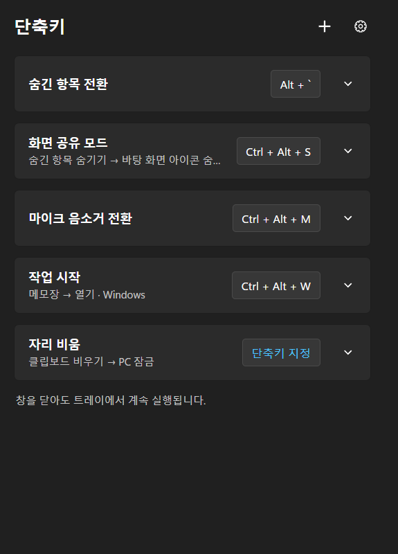
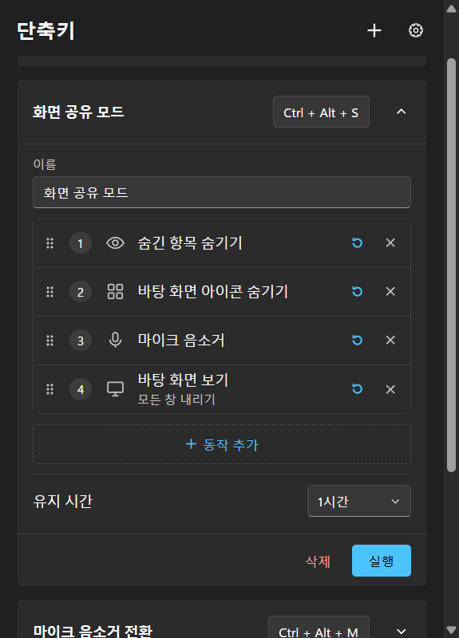

# Keyscene

One keyboard shortcut runs several Windows actions; press it again to put them back. Windows 11 tray app, Korean UI.

단축키 하나로 Windows 동작 여러 개를 실행하고, 다시 누르면 원래대로 돌아가는 트레이 프로그램입니다.

예: 화면 공유 전에 숨긴 파일·바탕 화면 아이콘을 숨기고 마이크를 끄고, 끝나면 같은 키로 원래대로.

## 설치

[Releases](https://github.com/Jong6e/keyscene/releases/latest)에서 `Keyscene_<버전>_x64-setup.exe`를 받아 실행합니다. Windows 11(64비트), 관리자 권한 불필요.

코드 서명이 없어 경고가 뜰 수 있습니다.

| 경고 | 할 일 |
| --- | --- |
| Edge "일반적으로 다운로드되지 않습니다" | **…** → **유지** |
| "Windows의 PC 보호" | **추가 정보** → **실행** |
| 스마트 앱 컨트롤이 차단 | 서명 없는 앱은 예외 없이 막힙니다. 끌지는 직접 판단하세요. |
| Defender가 격리 | **Windows 보안 → 보호 기록**에서 복원 후 다시 설치 |

릴리스의 SHA-256과 `Get-FileHash <파일>` 결과가 같으면 원본입니다. 설치 파일은 GitHub Actions가 이 저장소 소스로 만듭니다.

## 사용법

- **+** 로 단축키를 만들고 키 조합과 동작을 정합니다. 처음에는 추천 단축키 3개가 키 없이 들어 있습니다.
- ↩ 표시가 있는 동작은 다시 누르면 원래대로 돌아갑니다. **유지 시간**을 정하면 그 시간 뒤 저절로 돌아갑니다.
- 트레이 아이콘: 왼쪽 클릭은 창, 오른쪽 클릭은 단축키 목록. 빨간 배지는 마이크 음소거 중입니다.
- 설정(⚙): 시작 시 자동 실행, 일시 중지, 단축키를 쓰지 않을 앱, 새 버전 확인.
- 명령줄: `keyscene.exe --run "단축키 이름"`

**동작:** 앱·파일·웹사이트 열기, 앱 최소화·닫기, 창 최소화·최대화·맨 위 고정, 바탕 화면 보기, 스피커·마이크 음소거, 음량, 미디어 키, 숨긴 항목, 바탕 화면 아이콘, 어둡게·밝게, 파일·폴더 숨기기, 모니터 끄기, 잠금, 절전, 클립보드 비우기, 화면 캡처, 단축키 보내기, 글자 입력, 기다리기

## 문제가 생기면

- 단축키가 안 들으면 다른 프로그램이 같은 조합을 쓰는 경우가 많습니다. 창에 이유가 표시됩니다.
- 관리자 권한 창에는 '단축키 보내기'·'글자 입력'이 동작하지 않습니다.
- 오류 기록: `%APPDATA%\Keyscene\keyscene.log`. [이슈](https://github.com/Jong6e/keyscene/issues)에 붙일 때는 경로 속 사용자 이름을 지워 주세요.

## 제거와 개인 정보

- **설정 → 앱 → 설치된 앱**에서 제거합니다. '앱 데이터 삭제'를 고르면 설정도 지웁니다.
- 사용 정보를 모으지 않습니다. 인터넷은 '새 버전 확인'을 누를 때와 단축키로 웹사이트를 열 때만 씁니다.

[MIT](LICENSE) · [개발 문서](docs/DEVELOPMENT.md)
