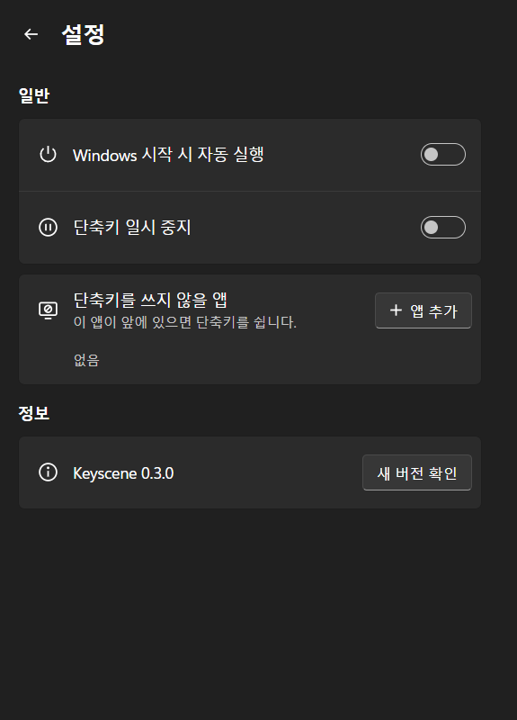

# Keyscene

**Run several Windows actions with one keyboard shortcut — and undo them with the same key.**
Keyscene is a small tray app for Windows 11. A shortcut can, for example, hide hidden files, hide desktop icons and mute the microphone before a screen share; pressing it again puts everything back. The interface is in Korean.

---

단축키 하나로 Windows 동작 여러 개를 실행하고, **같은 키를 다시 누르면 원래대로 돌아가는** 트레이 프로그램입니다.

<p align="center"></p>

## 이럴 때 씁니다

- **화면 공유를 시작할 때**: 숨긴 파일 숨기기 → 바탕 화면 아이콘 숨기기 → 마이크 음소거를 키 하나로. 끝나면 같은 키로 원래대로.
- **숨긴 파일을 잠깐 볼 때**: <kbd>Alt</kbd>+<kbd>`</kbd>로 보이고 다시 누르면 숨김. 켜 둔 걸 잊어도 정해 둔 시간 뒤 저절로 원래대로 돌아가게 할 수 있습니다.
- **작업 시작할 때**: 메모장·브라우저(원하는 프로필)·폴더를 원하는 모니터와 위치에 한 번에 열기.
- **자리 비울 때**: 클립보드 비우기 → PC 잠금.

## 설치

1. [Releases](https://github.com/Jong6e/keyscene/releases/latest)에서 `Keyscene_<버전>_x64-setup.exe`를 받아 실행합니다. 관리자 권한은 필요 없습니다.
2. 설치가 끝나면 Keyscene 창이 한 번 열립니다. 그 뒤로는 작업 표시줄 오른쪽 알림 영역에 스위치 모양 아이콘으로 있습니다(안 보이면 **^**).

**지원:** Windows 11(64비트). ARM 노트북에서도 에뮬레이션으로 동작합니다. 화면을 그리는 Microsoft Edge WebView2가 없으면 설치하면서 받습니다(대부분의 Windows 11에는 이미 있습니다).

### 내려받을 때 뜨는 경고

Keyscene은 코드 서명(누가 만들었는지 증명하는 유료 인증서)이 없어서, 처음 받는 사람에게 Windows와 브라우저가 경고를 띄웁니다.

| 상황 | 할 일 |
| --- | --- |
| Edge: "일반적으로 다운로드되지 않습니다" | 다운로드 항목의 **…** → **유지** → **그래도 유지** |
| 실행할 때 파란 "Windows의 PC 보호" 창 | **추가 정보** → **실행** |
| "스마트 앱 컨트롤이 이 앱을 차단했습니다" | 서명 없는 앱은 예외 없이 막힙니다. Windows 보안 → 앱 및 브라우저 컨트롤 → 스마트 앱 컨트롤을 끄면 설치할 수 있습니다. 끌지는 직접 판단하세요. |
| Windows 보안이 "위협이 발견되었습니다"로 격리 | 서명이 없는 새 프로그램이 시작 프로그램에 자기를 등록하면 Microsoft Defender가 악성 행동(`Behavior:Win32/Persistence.A!ml`)으로 오인하기도 합니다. 받은 파일이 맞는지 아래 방법으로 확인한 뒤, **Windows 보안 → 바이러스 및 위협 방지 → 보호 기록**에서 그 항목을 **복원**(허용)하고 다시 설치하세요. |
| 다른 백신이 막음 | 서명이 없는 데다 전역 단축키·키 입력 보내기·파일 숨기기는 의심받기 쉬운 기능입니다. 파일을 확인한 뒤 예외로 등록하세요. |

**받은 파일이 맞는지 확인:** 릴리스에 적힌 SHA-256 값과 아래 명령의 결과가 같으면 중간에 바뀌지 않은 파일입니다. 설치 파일은 이 저장소의 소스로 GitHub Actions가 직접 만듭니다.

```powershell
Get-FileHash .\Keyscene_0.3.0_x64-setup.exe -Algorithm SHA256
```

## 사용법

### 단축키 만들기

1. 트레이 아이콘을 누르면 창이 열립니다. 처음에는 추천 단축키 3개(숨긴 항목 전환, 화면 공유 모드, 마이크 음소거 전환)가 들어 있습니다.
2. **+** 로 새 단축키를 만들고, 이름과 키 조합을 정한 뒤 **동작 추가**로 동작을 순서대로 넣습니다.
3. 키를 누르거나 트레이 메뉴에서 이름을 누르면 실행됩니다.

<p align="center"></p>

**다시 누르면 원래대로:** ↩ 표시가 붙은 동작은 같은 키를 한 번 더 누르면 실행 전으로 돌아갑니다. 실행한 뒤 직접 바꾼 것은 건드리지 않습니다. 이미 모두 직접 원래대로 해 두었다면 그 누름은 다시 실행합니다.
**유지 시간:** 단축키마다 5분~1시간이 지나면 저절로 원래대로 돌아가게 할 수 있습니다. 남은 시간은 트레이 메뉴에 보입니다.

### 넣을 수 있는 동작

| 분류 | 동작 |
| --- | --- |
| 앱·파일·웹 | 앱 열기(모니터, 최대화·절반 배치, 원래대로 할 때 최소화·닫기), 파일·폴더 열기, 웹사이트 열기(Chrome·Edge 프로필, 새 창, 시크릿 창), 앱 최소화·닫기 |
| 창 | 바탕 화면 보기, 현재 창 최소화·최대화·맨 위 고정 |
| 소리 | 스피커 음소거, 음량 맞추기, 마이크 음소거, 재생/일시 중지·다음 곡·이전 곡 |
| 화면·탐색기 | 숨긴 항목, 바탕 화면 아이콘, 어둡게·밝게 모드, 모니터 끄기 |
| 파일 숨기기 | 선택한 항목 숨기기/숨김 해제, 하위 항목까지 숨기기(탐색기에서 선택한 폴더 또는 지정한 폴더, 10분 동안 트레이에서 실행 취소) |
| 시스템 | PC 잠금, 절전, 클립보드 비우기(Win+V 기록 포함), 화면 캡처 |
| 입력 | 단축키 보내기, 글자 입력, 기다리기 |

숨긴 항목·바탕 화면 아이콘·마이크·스피커·어둡게/밝게는 켜기·끄기 말고 **전환**(지금 상태를 뒤집기)도 고를 수 있습니다.

### 트레이 아이콘

- 왼쪽 클릭: 창 열기 / 오른쪽 클릭: 단축키 목록(실행 중이면 체크), 단축키 일시 중지, 종료
- 빨간 마이크 배지: 마이크 음소거 중 / 일시 중지 배지: 단축키를 잠시 끈 상태
- 창을 닫아도 Keyscene은 계속 실행됩니다. 끄려면 메뉴의 **종료**.

### 설정 (창 오른쪽 위 ⚙)

<p align="center"></p>

- **Windows 시작 시 자동 실행**, **단축키 일시 중지**
- **단축키를 쓰지 않을 앱**: 게임처럼 같은 키를 쓰는 프로그램이 앞에 있는 동안 Keyscene 단축키가 잠시 쉽니다.
- **새 버전 확인**: 누를 때만 GitHub에 접속해 새 버전이 있는지 봅니다.

### 다른 프로그램에서 실행하기

마우스 버튼 프로그램이나 런처에 연결하면 키 없이도 실행할 수 있습니다. Keyscene이 꺼져 있으면 켜면서 실행합니다.

```
"%LOCALAPPDATA%\Keyscene\keyscene.exe" --run "화면 공유 모드"
```

## 문제가 생기면

| 증상 | 확인할 것 |
| --- | --- |
| 단축키가 듣지 않음 | 창의 그 단축키에 이유가 나옵니다. 대개 다른 프로그램이 같은 조합을 쓰고 있습니다. |
| 단축키가 엉뚱한 키에서 동작 | 키 위치는 영문(US)·한국어 자판 기준입니다. 독일어·프랑스어 자판 등에서는 다를 수 있습니다. |
| '단축키 보내기'·'글자 입력'이 안 됨 | 관리자 권한으로 실행 중인 창에는 Windows가 키 입력을 막습니다. |
| 창이 열리지 않음 | 안내 창이 뜨면 WebView2를 설치하세요. |

실패한 작업은 `%APPDATA%\Keyscene\keyscene.log`에 한 줄씩 남습니다. [이슈](https://github.com/Jong6e/keyscene/issues)로 알려 주실 때 붙여 주세요. **올리기 전에 경로 속 사용자 이름(`C:\Users\이름\...`)은 지워 주세요.** 이슈는 누구나 볼 수 있습니다.

## 제거

**설정 → 앱 → 설치된 앱 → Keyscene → 제거**. 시작 프로그램 항목도 함께 지워집니다.

- 제거 화면에서 **앱 데이터 삭제**를 고르면 단축키 설정까지 지웁니다.
- 숨긴 항목 보기, 바탕 화면 아이콘 같은 Windows 설정은 제거할 때의 상태로 남습니다.

## 개인 정보

- Keyscene은 사용 정보를 모으지 않습니다. 인터넷에는 **새 버전 확인**을 누를 때(GitHub)와, 단축키에 넣은 웹사이트를 열 때만 접속합니다.
- 설정과 기록은 이 PC의 `%APPDATA%\Keyscene`에만 저장됩니다.

## 라이선스

[MIT](LICENSE). 만드는 방법은 [개발 문서](docs/DEVELOPMENT.md)에 있습니다.
